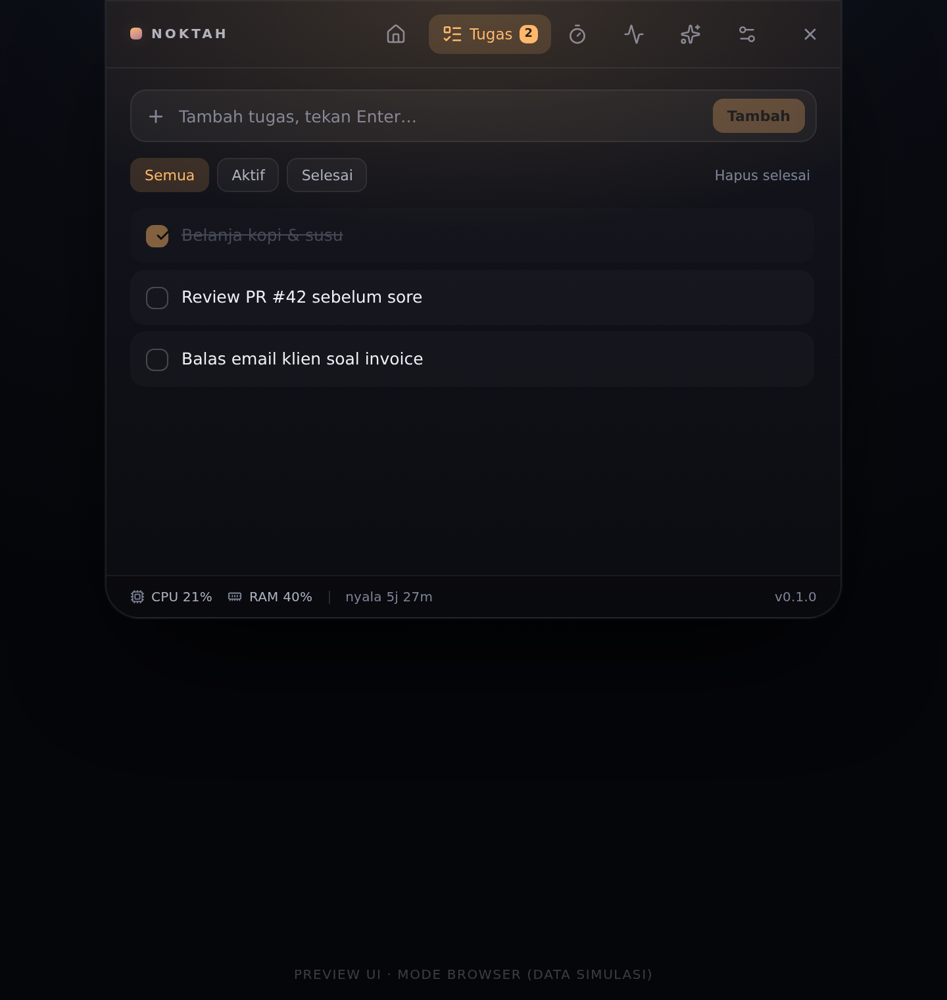
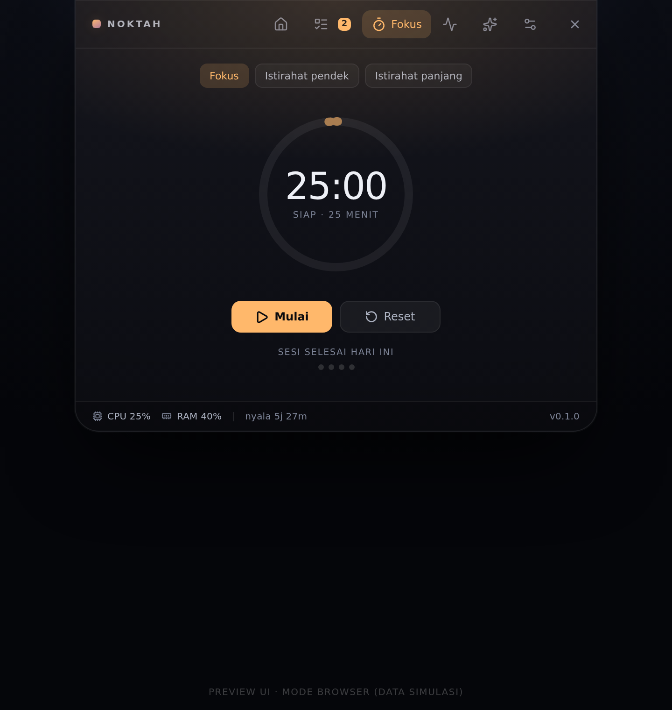
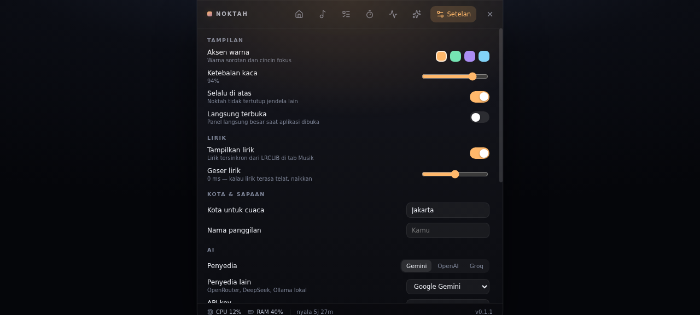

# Noktah

Notch interaktif untuk Windows 10/11. Satu titik kecil di tengah atas layar —
jam, cuaca, tugas, timer fokus, statistik sistem, lirik, kuota, dan chat AI —
semuanya muncul begitu kursor didekatkan, lalu mengecil lagi saat kursor pergi.

Dibangun sebagai **aplikasi Rust native** dengan `egui`/`eframe`. Tidak ada
WebView, tidak ada runtime tambahan: satu exe sekitar 9 MB yang langsung
menggambar sendiri ke layar.

> Ini rilis **1.0.0** — versi pertama yang dipublikasikan. Sebelumnya ada
> aplikasi Tauri 2 + React, tapi sudah tidak ada di pohon kerja ini: aplikasi
> sekarang digambar sendiri dengan Rust, dan logika yang dulu ada di frontend
> kini hidup di `native/core` (lirik, format, i18n, pill, pengingat) lengkap
> dengan test-nya.

## Kenapa dibuat

Kebanyakan widget desktop itu berat, selalu terlihat, dan mencuri ruang layar.
Noktah mengambil pendekatan sebaliknya: satu notch kecil di tengah atas yang
**hanya hidup saat kamu dekati**. Kalau tidak dipakai, ia cuma satu garis tipis
berisi jam dan suhu.

## Tampilan


| Tugas | Fokus |
| --- | --- |
|  |  |



## Unduh

Ambil `noktah-<versi>-win64.zip` dari
[halaman Releases](https://github.com/AffanShz/noktah/releases), lalu ekstrak dan
jalankan `noktah-native.exe`. Zip-nya juga berisi `noktah-hook.exe` (pendamping
halaman Agent) dan `BACA-DULU.txt` berisi SHA-256 untuk memeriksa keutuhan file.

Butuh Windows 10/11 64-bit. Tidak perlu install apa pun — tidak ada WebView2,
tidak ada runtime tambahan, tidak ada hak admin.

> **Windows protected your PC?** Klik **More info** → **Run anyway**. Aplikasi ini
> belum ditandatangani secara digital, jadi SmartScreen dan sebagian pemindai
> antivirus bisa memperingatkan karena bentuk overlay-nya mirip keylogger —
> padahal yang dilakukannya hanya menggambar di layar.


## Fitur

| Halaman | Isi |
| --- | --- |
| **Beranda** | Jam besar, tanggal Indonesia, lagu yang sedang diputar (ringkas), dan sisa kuota Antigravity dari 9Router |
| **Musik** | Pemutar dari Windows SMTC: sampul album, judul/artis/album, progres yang bisa diklik, play/pause, next/prev, dan lirik tersinkron |
| **Now Playing** | Tampilan mini satu kolom tanpa blok lirik, dengan posisi tombol transport yang sama persis seperti di halaman Musik |
| **Tugas** | Tambah/centang/hapus, pengingat berjam yang memunculkan pita di bawah notch, tersimpan lokal |
| **Fokus** | Timer Pomodoro dengan cincin progres dan hitungan sesi harian |
| **Hidrasi** | Pencatat minum harian: cincin di kiri, status dan baris aksi di kanan |
| **Sistem** | Cuaca, CPU, dan memori sebagai tiga kartu, dengan sparkline |
| **Tanya** | Chat AI streaming dengan API key sendiri: Gemini, OpenAI, Groq, OpenRouter, DeepSeek, atau Ollama lokal |
| **Agent** | Status Claude Code dan persetujuan izin langsung dari notch, dengan maskot |

Detail lain:

- Panel **menyesuaikan tinggi** dengan isi halaman, dengan animasi pegas.
- **Hit-test kursor** di Rust: area transparan di bawah notch tidak menelan klik
  milik aplikasi lain.
- **Tray icon** + menu, dan hotkey **Alt+N** untuk memunculkan notch.
- Baris minimized elastis: tujuh item yang bisa dinyalakan/dimatikan, empat
  preset, dan lirik yang bergulir saat teks tidak muat.
- Semua data tersimpan di PC sendiri (`%APPDATA%\Noktah`).

## Cuaca tanpa API key

Cuaca memakai [Open-Meteo](https://open-meteo.com) — gratis dan tanpa
pendaftaran. Tidak ada key yang perlu kamu tempel untuk fitur ini.

## Musik: Spotify, YouTube Music, VLC — semuanya

Noktah membaca **SMTC** (System Media Transport Controls), API media resmi
Windows. Artinya aplikasi apa pun yang muncul di widget volume Windows otomatis
terbaca di sini: Spotify, YouTube Music di browser, VLC, Groove, dan seterusnya.
Tidak ada plugin, tidak ada login, tidak ada API key.

Yang dibaca: judul, artis, album, sampul, posisi lagu, dan status putar. Yang
bisa dikendalikan: play/pause, lagu berikutnya/sebelumnya, dan lompat ke posisi
tertentu dengan mengklik progress bar.

Saat musik diputar, notch yang mengecil ikut melebar dan menampilkan judul lagu
plus equalizer kecil. Lirik diambil dari [LRCLIB](https://lrclib.net) dengan
pencocokan berskor, cache di disk, dan retry saat server membalas 429/5xx.

## AI butuh key milikmu sendiri

Noktah **tidak menyertakan API key apa pun**. Buka `Setelan → AI`, tempel key
dari penyedia yang kamu pakai, dan model akan memanggil endpoint-nya langsung
dari PC-mu. Key dienkripsi dengan **DPAPI** Windows, jadi hanya akun pengguna
yang sama di mesin yang sama yang bisa membukanya, dan key tidak pernah masuk
`settings.json`.

Penyedia yang sudah terisi presetnya: Gemini, OpenAI, OpenRouter, Groq, DeepSeek,
dan Ollama (`http://localhost:11434/v1`, tanpa key).

## Menjalankan saat development

Butuh Rust stable dan toolchain **MSVC** (`x86_64-pc-windows-msvc`) — MSVC
dipakai, bukan MinGW, karena binary hasilnya memakai runtime Microsoft dan jauh
lebih jarang kena flag heuristik antivirus.

```bash
cd native
cargo run --release
```

Menjalankan test:

```bash
cd native
cargo test
```

## Build rilis

```bash
cd native
cargo build --release --target x86_64-pc-windows-msvc
```

Hasilnya dua biner di folder yang sama:

- `noktah-native.exe` — aplikasinya (sekitar 9 MB).
- `noktah-hook.exe` — biner pendamping halaman Agent (sekitar 150 KB).

Simpan keduanya di folder yang sama. Halaman Agent tidak berfungsi tanpa
`noktah-hook.exe`; kalau kamu tidak memakainya, file itu boleh diabaikan.

**Tanpa Windows?** Repo ini punya GitHub Actions:

- `.github/workflows/native-preview.yml` — menjalankan test lalu build preview
  MSVC setiap push ke `develop` yang menyentuh `native/`; artifact
  `noktah-native-msvc`.
- `.github/workflows/release-native.yml` — menjalankan test, build, lalu
  menerbitkan GitHub Release (beserta kedua biner dan SHA-256) begitu ada tag
  `v*`.

Keduanya memeriksa `VERSIONINFO` hasil build: kalau kosong, resource gagal
ditanam dan build seperti itu ditolak, karena justru itu yang paling sering
dituduh virus oleh pemindai.

## Struktur

```
native/                  workspace Cargo aplikasi
  core/src/              logika murni, tanpa jendela/disk/jaringan
    lrc.rs lyrics.rs     parser dan pencocokan lirik
    model.rs settings.rs tipe bersama dan setelan
    format.rs i18n.rs    format angka/tanggal dan kamus ID/EN
    pill.rs reminders.rs baris minimized dan penjadwalan pengingat
  app/src/
    application/         use case dan trait port (Clock, Network, Store, ...)
    infrastructure/      adapter nyata: SMTC, Win32, DPAPI, cuaca, AI, IPC
    presentation/        seluruh UI egui
      pages/             satu berkas per halaman notch
      shell/             bingkai notch: pill ↔ panel, hover intent
      layout.rs style.rs theme.rs widgets.rs
  hook/src/main.rs       biner pendamping ringan untuk hook Claude Code
assets/icons/            sumber ikon (SVG/PNG) yang digambar ulang secara prosedural
docs/                    roadmap, catatan gerak, rencana
```

## Alur kerja

`main` = production, `develop` = integrasi. Kerja di branch `feat/...` atau
`fix/...`, PR ke `develop`, rilis dengan tag `v*` dari `main`.

Detail konvensi branch, format commit, dan langkah rilis ada di
[CONTRIBUTING.md](CONTRIBUTING.md).

## Keamanan & privasi

- Tidak ada telemetri, tidak ada akun, tidak ada server milik proyek ini.
- Koneksi keluar hanya ke: Open-Meteo (cuaca), LRCLIB (lirik), dan penyedia AI
  yang kamu pilih sendiri. Tidak ada CSP webview, karena tidak ada webview.
- API key AI dienkripsi DPAPI dan tidak pernah ditulis ke `settings.json`.
- File `.env*`, `secret.json`, dan `secret.bin` sudah masuk `.gitignore`.

## Status

Versi 1.0.0. Belum ada code signing, jadi SmartScreen akan memberi peringatan
saat pertama dijalankan; periksa SHA-256 yang disertakan di paket rilis.

Rencana pengembangan dan utang teknis ada di [docs/ROADMAP.md](docs/ROADMAP.md).
Riwayat perubahan ada di [CHANGELOG.md](CHANGELOG.md).

## Lisensi

MIT
