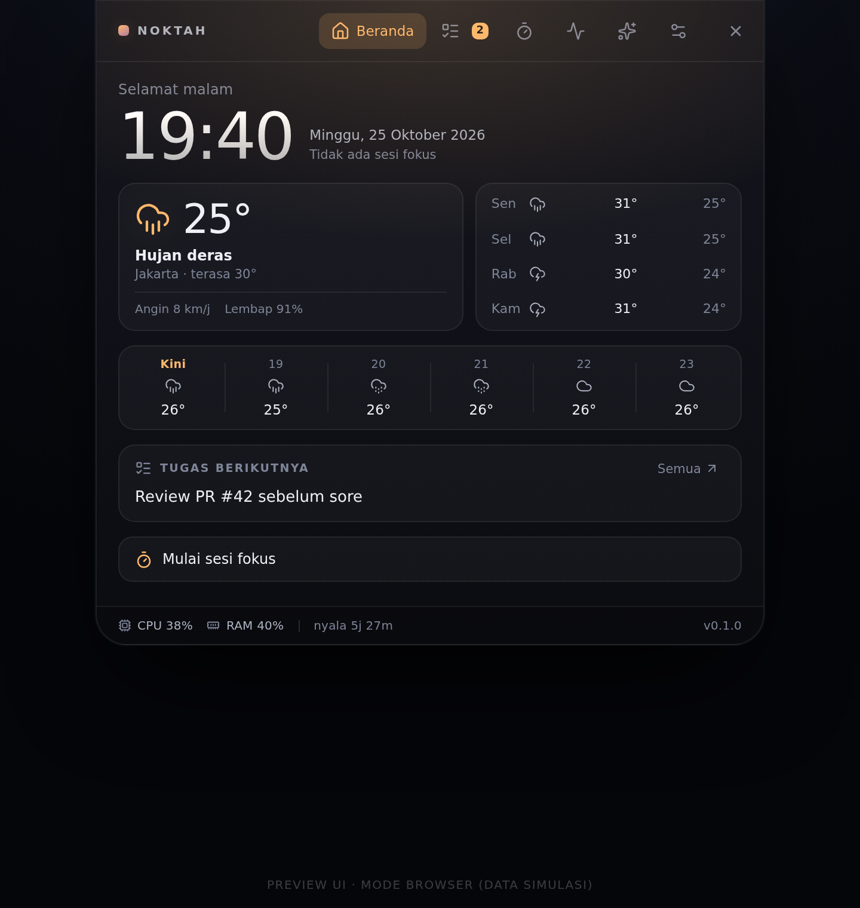

# Noktah

Notch interaktif untuk Windows 10/11. Satu titik kecil di tengah atas layar —
jam, musik, lirik dinamis, maskot Noki, tugas, timer fokus, statistik sistem, kuota, dan chat AI —
semuanya muncul begitu kursor didekatkan, lalu mengecil lagi saat kursor pergi.

Dibangun sebagai **aplikasi Rust native** dengan `egui`/`eframe`. Tidak ada
WebView, tidak ada runtime tambahan: satu file exe sekitar 9 MB yang langsung
menggambar sendiri ke layar dengan performa tinggi dan konsumsi memori minim.

## Kenapa dibuat

Kebanyakan widget desktop itu berat, selalu terlihat, dan mencuri ruang layar.
Noktah mengambil pendekatan sebaliknya: satu notch kecil di tengah atas yang
**hanya hidup saat kamu dekati**. Kalau tidak dipakai, ia menyusut menjadi satu baris tipis
(pill minimized) di tepi atas layar yang tetap informatif.

## Tampilan



| Musik | Tugas |
| --- | --- |
|  |  |

| Fokus | Setelan |
| --- | --- |
|  |  |

Saat minimized, notch menyusut menjadi garis tipis (pill) yang dinamis:


## Fitur Utama

### 1. Maskot Noki & Universal Gaze Tracking
- **Noki si Blob Ungu**: Karakter maskot interaktif yang hidup di notch dan baris minimized.
- **Universal Gaze Tracking**: Bola mata Noki bereaksi dinamis melirik ke elemen yang sedang aktif — memperhatikan lirik lagu yang sedang bergulir, melirik kursor mouse saat mendekat, mengamati tombol saat di-hover, atau siaga saat ada notifikasi.
- **Ekspresi Kontekstual**: Tidur saat santai/idle, fokus saat musik diputar, dan waspada saat menunggu izin Claude Code.

### 2. Musik & Lirik Cerdas
- **Integrasi Windows SMTC**: Terhubung otomatis dengan aplikasi pemutar media apa pun di Windows melalui API System Media Transport Controls (SMTC) tanpa plugin, login, atau token tambahan.
- **Slot Lirik Dinamis**: Pada baris minimized, lirik bergulir halus secara elastis bolak-balik tanpa menabrak kontrol media maupun maskot Noki.
- **Fallback Multi-Provider & Lirik Polos**: Mencari lirik tersinkronisasi (LRC) secara berjenjang. Bila lirik tersinkron tidak tersedia, Noktah otomatis menampilkan lirik polos (plain text) per baris agar teks lagu tetap dapat dibaca.
- **Seekable Lyrics**: Klik pada baris lirik di panel musik untuk langsung melompat (seek) ke bagian lagu tersebut.

### 3. Jendela Setelan Mandiri (Secondary Viewport)
- **Viewport Sekunder Native**: Jendela Setelan hadir dalam jendela mandiri terpisah yang elegan melalui teknologi *eframe secondary viewport*.
- **Always-on-Top & Independen**: Membuka dan mengubah setelan tidak lagi menutup notch utama, sehingga perubahan konfigurasi pill atau tema dapat langsung dipantau secara real-time.
- **Navigasi Tab Terstruktur**: Tata letak rapi untuk Umum, Tampilan, Baris Minimized, Musik & Lirik, AI, Kuota, dan Informasi Aplikasi.

### 4. Integrasi Claude Code & Persetujuan Cepat
- **Halaman Agent**: Menerima permintaan izin (*permission request*) dari Claude Code secara instan melalui named pipe `noktah-hook.exe`.
- **Auto-Minimize Mulus**: Notch langsung mengecil kembali secara otomatis setelah kamu menyetujui atau menolak aksi agent, menjaga fokus kerjamu tetap utuh.

### 5. Chat AI Privat dengan DPAPI
- Mendukung model AI pilihanmu sendiri: Google Gemini, OpenAI, OpenRouter, Groq, DeepSeek, atau model lokal Ollama (`http://localhost:11434/v1`).
- Kunci API dienkripsi menggunakan **Windows DPAPI** — hanya dapat didekripsi oleh akun pengguna di PC yang sama, tidak pernah disimpan dalam format teks biasa di `settings.json`.

### 6. Custom Status Tiles (`noktah-hook`)
- Terima hingga 6 kartu status dan metrik kustom (CI build, server, kuota, sensor) langsung ke halaman **System** lewat perintah `noktah-hook tile`.
- Mendukung nada status, progres 0–100%, kadaluwarsa otomatis (`--ttl`), serta penyematan ringkas ke pill minimal (`--pin-mini`).

### 7. Liquid Glass & Preset Tema
- 5 preset tampilan kurasi (*Obsidian*, *Liquid Glass*, *Midnight Frost*, *Aurora*, *Emerald Slate*) di **Setelan → Tampilan**.
- Kustomisasi warna aksen `#RRGGBB`, *Edge Specular Rim*, *Glass Blur Radius*, *Saturation Boost*, serta ekspor/impor preset JSON satu klik.

---

## Mengendalikan Notch

- **Dekatkan kursor** ke tepi atas layar untuk membuka panel notch, dan jauhkan kursor untuk menutupnya kembali secara otomatis.
- **Pintasan Alt+N**: Membuka atau menutup notch dari aplikasi apa pun.
- **Tray Icon**: Ikon di area notifikasi taskbar untuk akses cepat (Tampilkan, Sembunyikan, Mulai bersama Windows, Setelan, dan Keluar).
- **Mulai bersama Windows**: Mengatur registrasi autostart Windows secara sinkron dengan registry sistem.
- **Hormati Preferensi Gerakan**: Mengikuti opsi "kurangi animasi" pada setelan aksesibilitas Windows.

Semua konfigurasi dan cache disimpan secara lokal di `%APPDATA%\Noktah`.

## Baris Minimized

Saat notch tertutup, tampilannya menyusut menjadi kapsul ramping (pill). Kamu dapat mengaktifkan item secara granular dari Setelan, atau memilih preset:

| Preset | Isinya |
| --- | --- |
| **Standar** | Sampul, judul, waveform, progres, jam, agent/Noki |
| **Mode Lirik** | Sampul, lirik dinamis, waveform, progres, agent/Noki |
| **Fokus Lirik** | Lirik dinamis dan progres lagu |
| **Lengkap** | Seluruh elemen preset menyala bersamaan |

*Catatan: Indikator CPU dan RAM memiliki sakelar independen di luar preset.*

## Unduh & Pemasangan

### Via `winget` (Rekomendasi)

```powershell
winget install AffanShz.Noktah
```

Instalasi `winget` memasang paket portabel (*nested portable installer*) ke cakupan pengguna secara bawaan (mendukung `--scope` secara dinamis di `winget`) sekaligus mendaftarkan alias perintah `noktah` dan `noktah-hook` secara otomatis.

### Unduh ZIP Manual

Ambil rilis biner siap pakai `noktah-<versi>-win64.zip` dari
[halaman Releases](https://github.com/AffanShz/noktah/releases), lalu ekstrak dan
jalankan `noktah-native.exe`.

Paket zip menyertakan:
- `noktah-native.exe` — biner utama aplikasi (±9 MB).
- `noktah-hook.exe` — biner pendamping integrasi agent & Custom Status Tiles (±150 KB).
- `BACA-DULU.txt` — checksum SHA-256 untuk memverifikasi integritas file.

Untuk memanggil `noktah-hook` dari terminal mana pun setelah ekstrak manual, aktifkan saklar **Daftarkan noktah-hook ke PATH** di **Setelan → AI → Integrasi Maskot & Agent Hooks (Noki)**.

### Penandatanganan Digital & SmartScreen

Workflow rilis CI mendukung penandatanganan digital otomatis melalui **Azure Trusted Signing** atau sertifikat **PFX Authenticode** (lihat [docs/DISTRIBUTION.md](docs/DISTRIBUTION.md) untuk konfigurasi secrets dan pengajuan manifest `winget-pkgs`).

> **Peringatan SmartScreen pada rilis unsigned?** Klik **More info** → **Run anyway**, dan periksa kesesuaian checksum SHA-256 di `BACA-DULU.txt`.

## Menjalankan saat Development

Membutuhkan Rust stable dengan toolchain **MSVC** (`x86_64-pc-windows-msvc`):

```bash
cd native
cargo run -p noktah-native --release
```

Jika toolchain default bukan MSVC, tentukan target secara eksplisit:

```bash
cd native
cargo run -p noktah-native --release --target x86_64-pc-windows-msvc
```

Menjalankan pengujian:

```bash
cd native
cargo test --workspace
```

## Membangun Rilis

```bash
cd native
cargo build -p noktah-native --release --target x86_64-pc-windows-msvc
```

Hasil biner berada di `native/target/x86_64-pc-windows-msvc/release/`.

## Struktur Repositori

```
native/                  Workspace Cargo aplikasi utama
  core/src/              Logika murni (tanpa GUI/Win32/jaringan)
    lrc.rs lyrics.rs     Parser dan evaluasi pencocokan lirik
    model.rs settings.rs Tipe model bersama dan manajemen setelan
    format.rs i18n.rs    Format waktu/data dan kamus bahasa (ID/EN)
    pill.rs reminders.rs Logika baris minimized dan penjadwalan
  app/src/
    application/         Use cases dan trait ports (Clock, Network, Store, ...)
    infrastructure/      Adapter sistem nyata: SMTC, Win32, DPAPI, Cuaca, AI, IPC
    presentation/        Seluruh antarmuka egui
      pages/             Halaman notch: home, music, focus, tasks, system, ask, agent, settings
      shell/             Kerangka notch: animasi pill ↔ panel, gaze tracking, viewport
      layout.rs style.rs theme.rs widgets.rs
  hook/src/main.rs       Biner ringan penerus event Claude Code
assets/icons/            Aset ikon SVG dan resource aplikasi
docs/                    Dokumentasi teknis, screenshot, dan roadmap
```

## Keamanan & Privasi

- **100% Bebas Telemetri**: Tidak ada pelacak, tidak ada akun pengguna, dan tidak ada server penampung milik Noktah.
- **Koneksi Jaringan Langsung**:
  - Cuaca: `api.open-meteo.com` (tanpa API key).
  - Lirik: Layanan lirik publik daring (di-cache lokal di `%APPDATA%\Noktah\lyrics`).
  - AI: Langsung ke penyedia yang kamu konfigurasikan (Gemini, OpenAI, Groq, DeepSeek, dsb.).
  - Kuota: Server lokal Antigravity di `127.0.0.1`.
- **Enkripsi Kredensial**: API key AI diamankan melalui Windows DPAPI dan tidak disimpan dalam bentuk teks biasa.

## Lisensi

Didistribusikan di bawah lisensi [MIT](LICENSE).
