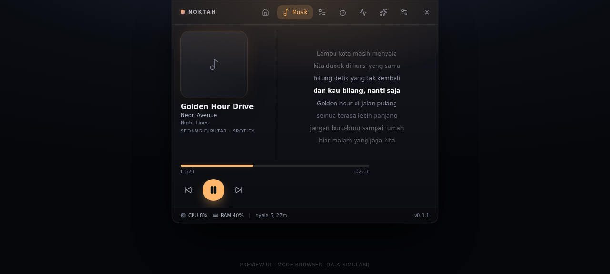
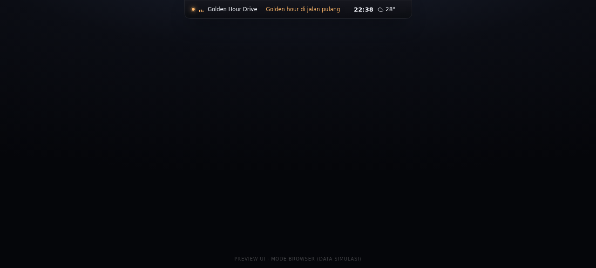
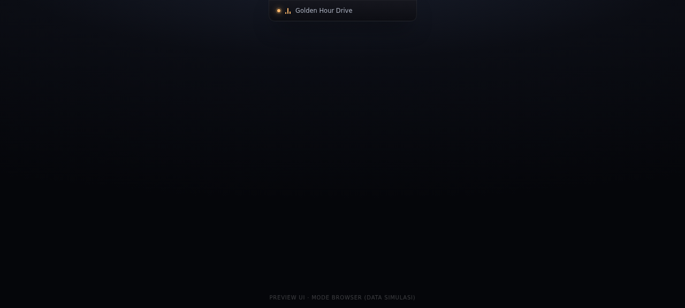

# Noktah

Notch interaktif untuk Windows 10/11. Satu titik kecil di tengah atas layar —
jam, musik, lirik, tugas, timer fokus, hidrasi, statistik sistem, kuota, dan chat
AI — semuanya muncul begitu kursor didekatkan, lalu mengecil lagi saat kursor
pergi.

Dibangun sebagai **aplikasi Rust native** dengan `egui`/`eframe`. Tidak ada
WebView, tidak ada runtime tambahan: satu exe sekitar 9 MB yang langsung
menggambar sendiri ke layar.

> Ini rilis **1.0.0** — versi pertama yang dipublikasikan. Sebelumnya ada
> aplikasi Tauri 2 + React, tapi sudah tidak ada di pohon kerja ini: aplikasi
> sekarang digambar sendiri dengan Rust, dan logika yang dulu ada di frontend
> kini hidup di `native/core` (lirik, format, i18n, pill, pengingat) lengkap
> dengan test-nya.

## Kenapa dibuat

Kebanyakan widget desktop itu berat, selalu terlihat, dan mencuri ruang layar.
Noktah mengambil pendekatan sebaliknya: satu notch kecil di tengah atas yang
**hanya hidup saat kamu dekati**. Kalau tidak dipakai, ia cuma satu garis tipis
di tepi atas layar.

## Tampilan


| Musik | Tugas |
| --- | --- |
|  |  |

| Fokus | Setelan |
| --- | --- |
|  |  |

Saat minimized, notch jadi garis tipis yang isinya bisa kamu pilih sendiri:

| Musik + lirik | Hanya lirik |
| --- | --- |
|  |  |



## Unduh

Ambil `noktah-<versi>-win64.zip` dari
[halaman Releases](https://github.com/AffanShz/noktah/releases), lalu ekstrak dan
jalankan `noktah-native.exe`. Zip-nya juga berisi `noktah-hook.exe` (pendamping
halaman Agent) dan `BACA-DULU.txt` berisi SHA-256 untuk memeriksa keutuhan file.

Butuh Windows 10/11 64-bit. Tidak perlu install apa pun — tidak ada WebView2,
tidak ada runtime tambahan, tidak ada hak admin.

> **Windows protected your PC?** Klik **More info** → **Run anyway**. Aplikasi ini
> belum ditandatangani secara digital, jadi SmartScreen dan sebagian pemindai
> antivirus bisa memperingatkan karena bentuk overlay-nya mirip keylogger —
> padahal yang dilakukannya hanya menggambar di layar.

## Halaman

Sembilan halaman, dan tujuh di antaranya ikut siklus tombol chevron di bilah
bawah.

| Halaman | Isi |
| --- | --- |
| **Beranda** | Lagu yang sedang diputar (ringkas, tanpa lirik) dan sisa kuota Antigravity dari 9Router — dua cincin (sesi & minggu) plus tombol segarkan |
| **Musik** | Pemutar dari Windows SMTC: sampul album, judul/artis/album, progres yang bisa diklik, play/pause, next/prev, dan lirik tersinkron |
| **Tugas** | Tambah/centang/hapus, tersimpan lokal |
| **Fokus** | Timer Pomodoro dengan cincin progres dan hitungan sesi |
| **Sistem** | Cuaca, CPU, dan memori sebagai tiga kartu, dengan sparkline |
| **Tanya** | Chat AI streaming dengan API key sendiri: Gemini, OpenAI, OpenRouter, Groq, DeepSeek, atau Ollama lokal |
| **Agent** | Status Claude Code dan persetujuan izin langsung dari notch, dengan maskot Noki |
| **Hidrasi** | Pencatat minum: cincin di kiri, status dan baris aksi di kanan, dengan tombol reset manual |
| **Now Playing** | Pemutar mini satu kolom tanpa lirik, posisi tombol transport identik dengan halaman Musik |

## Baris minimized

Saat notch tertutup, isinya jadi satu garis tipis. Sepuluh item bisa kamu
nyalakan atau matikan satu per satu dari Setelan, dan empat preset menyiapkan
kombinasinya sekaligus:

| Preset | Isinya |
| --- | --- |
| **Standar** | Sampul, judul, waveform, progres, jam, agent |
| **Mode Lirik** | Sampul, lirik, waveform, progres, agent |
| **Fokus Lirik** | Lirik dan progres saja |
| **Lengkap** | Semuanya |

Item yang bisa dinyalakan: sampul, judul, lirik, kontrol transport, waveform,
progres, jam, CPU, RAM, dan agent. Lebarnya dihitung dari item yang menyala
saja, jadi pill ikut menyusut. Lirik yang tidak muat bergulir sendiri
(~42 px/detik, putaran mulus tanpa lompatan); teks yang muat tetap diam.

## Mengendalikan notch

- **Dekatkan kursor** ke tepi atas layar untuk membuka notch, dan menjauh untuk
  menutupnya lagi.
- **Alt+N** memunculkan notch dari mana saja.
- **Tray icon** di sudut taskbar: menu berisi Tampilkan, Sembunyikan, Mulai
  bersama Windows, dan Keluar.
- **Mulai bersama Windows** bisa dinyalakan dari tray atau Setelan; statusnya
  dibaca dari registry, jadi selalu sesuai keadaan sebenarnya.
- Setelan "kurangi animasi" Windows dihormati — animasi dimatikan, bukan
  diganti versi yang lebih cepat.

Semua data disimpan di PC sendiri, di `%APPDATA%\Noktah`.

## Cuaca tanpa API key

Cuaca memakai [Open-Meteo](https://open-meteo.com) — gratis dan tanpa
pendaftaran. Tidak ada key yang perlu kamu tempel untuk fitur ini.

## Musik: Spotify, YouTube Music, VLC — semuanya

Noktah membaca **SMTC** (System Media Transport Controls), API media resmi
Windows. Artinya aplikasi apa pun yang muncul di widget volume Windows otomatis
terbaca di sini: Spotify, YouTube Music di browser, VLC, Groove, dan seterusnya.
Tidak ada plugin, tidak ada login, tidak ada API key.

Yang dibaca: judul, artis, album, sampul, posisi lagu, dan status putar. Yang
bisa dikendalikan: play/pause, lagu berikutnya/sebelumnya, dan lompat ke posisi
tertentu dengan mengklik progress bar.

Saat musik diputar, notch yang mengecil ikut menampilkan sampul, judul, dan
equalizer kecil.

## Lirik

Lirik diambil berurutan dari empat sumber sampai ada yang cocok:

1. [LRCLIB](https://lrclib.net) — pencarian berskor dengan retry 429/5xx
2. BetterLyrics (TTML Apple Music)
3. NetEase Cloud Music
4. KuGou

Hasilnya di-cache ke disk, jadi lagu yang sama tidak diambil dua kali. Baris
yang bisa diklik bekerja sebagai seek, dan auto-scroll berhenti 4 detik setelah
kamu memilih baris supaya sempat dibaca.

## AI butuh key milikmu sendiri

Noktah **tidak menyertakan API key apa pun**. Buka `Setelan → AI`, tempel key
dari penyedia yang kamu pakai, dan model akan memanggil endpoint-nya langsung
dari PC-mu. Key dienkripsi dengan **DPAPI** Windows, jadi hanya akun pengguna
yang sama di mesin yang sama yang bisa membukanya, dan key tidak pernah masuk
`settings.json`.

Enam penyedia sudah terisi presetnya: Google Gemini, OpenAI, OpenRouter, Groq,
DeepSeek, dan Ollama (`http://localhost:11434/v1`, tanpa key).

## Halaman Agent

Halaman Agent menampilkan status Claude Code dan meminta persetujuan izin
langsung dari notch. Datanya datang lewat named pipe dari `noktah-hook.exe`,
biner pendamping yang meneruskan event Claude Code.

Agar bekerja, `noktah-hook.exe` harus didaftarkan sebagai hook Claude Code
sendiri — Noktah tidak mengubah konfigurasi Claude Code-mu secara otomatis.

Noktah sendiri tidak mencari file itu: ia hanya membuka named pipe
`\\.\pipe\noktah-<SID pengguna>`, dan `noktah-hook.exe` yang menyambung ke sana.
Jadi taruh biner itu di mana saja, lalu daftarkan sebagai hook
`PermissionRequest` di konfigurasi Claude Code-mu. Kalau tidak memakai Claude
Code, halaman ini boleh diabaikan.

## Menjalankan saat development

Butuh Rust stable dan toolchain **MSVC** (`x86_64-pc-windows-msvc`) — MSVC
dipakai, bukan MinGW, karena binary hasilnya memakai runtime Microsoft dan jauh
lebih jarang kena flag heuristik antivirus.

```bash
cd native
cargo run --release
```

Menjalankan test:

```bash
cd native
cargo test --workspace
```

## Build rilis

```bash
cd native
cargo build --release --target x86_64-pc-windows-msvc
```

Hasilnya dua biner:

- `noktah-native.exe` — aplikasinya (sekitar 9 MB).
- `noktah-hook.exe` — biner pendamping halaman Agent (sekitar 150 KB).

Simpan keduanya di tempat yang mudah kamu temukan.

**Tanpa Windows?** Repo ini punya GitHub Actions:

- `.github/workflows/native-preview.yml` — menjalankan test lalu build preview
  MSVC setiap push ke `develop` yang menyentuh `native/`; artifact
  `noktah-native-msvc`.
- `.github/workflows/release-native.yml` — menjalankan test, build, lalu
  menerbitkan GitHub Release (beserta kedua biner dan SHA-256) begitu ada tag
  `v*`.

Keduanya memeriksa `VERSIONINFO` hasil build: kalau kosong, resource gagal
ditanam dan build seperti itu ditolak, karena justru itu yang paling sering
dituduh virus oleh pemindai.

## Struktur

```
native/                  workspace Cargo aplikasi
  core/src/              logika murni, tanpa jendela/disk/jaringan
    lrc.rs lyrics.rs     parser dan pencocokan lirik
    model.rs settings.rs tipe bersama dan setelan
    format.rs i18n.rs    format angka/tanggal dan kamus ID/EN
    pill.rs reminders.rs baris minimized dan penjadwalan pengingat
  app/src/
    application/         use case dan trait port (Clock, Network, Store, ...)
    infrastructure/      adapter nyata: SMTC, Win32, DPAPI, cuaca, AI, IPC
    presentation/        seluruh UI egui
      pages/             satu berkas per halaman notch
      shell/             bingkai notch: pill ↔ panel, hover intent
      layout.rs style.rs theme.rs widgets.rs
  hook/src/main.rs       biner pendamping ringan untuk hook Claude Code
assets/icons/            sumber ikon (SVG/PNG) yang digambar ulang secara prosedural
docs/                    roadmap, catatan gerak, rencana
```

## Alur kerja

`main` = production, `develop` = integrasi. Kerja di branch `feat/...` atau
`fix/...`, PR ke `develop`, rilis dengan tag `v*` dari `main`.

Detail konvensi branch, format commit, dan langkah rilis ada di
[CONTRIBUTING.md](CONTRIBUTING.md).

## Keamanan & privasi

- Tidak ada telemetri, tidak ada akun, tidak ada server milik proyek ini.
- Koneksi keluar hanya untuk fitur yang kamu pakai:
  - **Cuaca** — `api.open-meteo.com` dan `geocoding-api.open-meteo.com`
  - **Lirik** — `lrclib.net`, dan kalau tidak ketemu berlanjut ke
    `lyrics-api.boidu.dev`, `music.163.com`, lalu `mobilecdn.kugou.com` +
    `lyrics.kugou.com`
  - **AI** — endpoint penyedia yang kamu pilih sendiri
  - **Kuota** — server 9Router lokal di `127.0.0.1`; kalau kamu tidak memakai
    9Router, permintaan ini gagal dan diabaikan
- API key AI dienkripsi DPAPI dan tidak pernah ditulis ke `settings.json`.
- File `.env*`, `secret.json`, dan `secret.bin` sudah masuk `.gitignore`.

## Status

Versi 1.0.0. Belum ada code signing, jadi SmartScreen akan memberi peringatan
saat pertama dijalankan; periksa SHA-256 yang disertakan di paket rilis.

Yang belum: **pengingat tugas belum tampil di layar.** Penjadwalan dan
pendeteksian tugas terlewat sudah jalan di `native/core/src/reminders.rs`, tapi
pesannya disimpan tanpa ada kode yang menggambarnya, dan tab Todo di Setelan
masih bertulis "coming soon". Panel juga memakai ukuran tetap (500×148 px, plus
46 px saat menu dock terbuka) yang dibuka dengan animasi pegas — isi halaman
yang menyesuaikan diri ke ruang itu, bukan panel yang tumbuh mengikuti isi.
Hitungan "sesi" Pomodoro dan "minum" hidrasi juga belum direset otomatis saat
hari berganti; tombol reset-nya manual.

Rencana pengembangan dan utang teknis ada di [docs/ROADMAP.md](docs/ROADMAP.md).
Riwayat perubahan ada di [CHANGELOG.md](CHANGELOG.md).

## Lisensi

MIT
